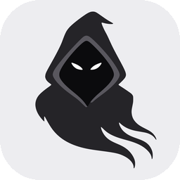
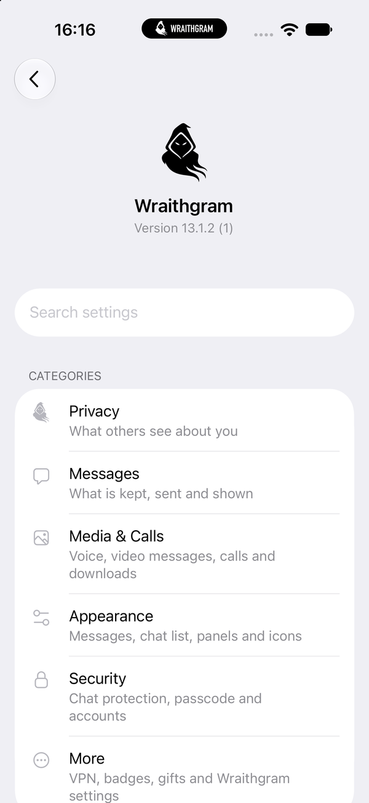
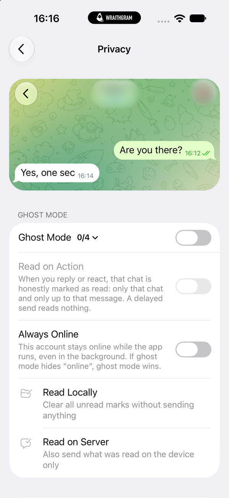
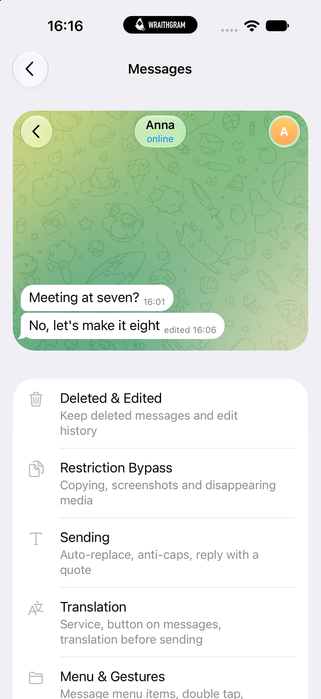
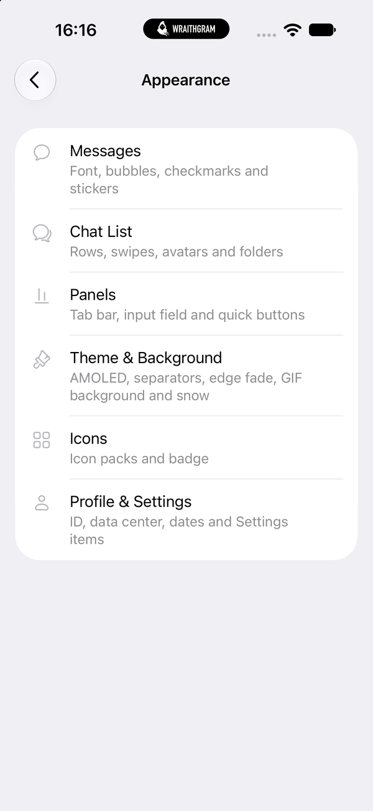

<p align="center">
  
</p>

<div align="center">

# Wraithgram

</div>

<p align="center">
  An unofficial Telegram client for iOS with privacy, message history and customization features.
</p>

<p align="center">
  
  
  
  
  <a href="LICENSE"></a>
</p>

<p align="center">
  🇬🇧 <b>English</b> · <a href="README.ru.md">🇷🇺 Русский</a>
</p>

Wraithgram is a fork of the official [Telegram iOS](https://github.com/TelegramMessenger/Telegram-iOS) app
(13.1.2), based on the [Ghostgram](https://github.com/ichmagmaus111/ghostgram) fork:

```text
Telegram iOS  ──▶  Ghostgram (ichmagmaus111/ghostgram)  ──▶  Wraithgram
  the app            privacy and customization features        this repository
```

All of its features are in **Settings → Wraithgram**, with the features that come from Swiftgram under
**Settings → Swiftgram** and **Settings → Swiftgram Pro**. Wraithgram is not affiliated with Telegram.

> [!WARNING]
> The repository ships with **Telegram's own public values**: `api_id` `8` and the bundle ID
> `ph.telegra.Telegraph` in `build-system/wraithgram-configuration.example.json`, as in Telegram iOS and
> Ghostgram. They are only good for a simulator build. **Replace them with your own** `api_id` and `api_hash`
> from [my.telegram.org](https://my.telegram.org) and your own bundle ID before you build for an iPhone or
> share the app. See [Building Wraithgram](docs/ios/building.md#before-you-start-your-own-api_id-and-bundle-id).

<p align="center">
  
  
  
  
</p>

## Get Wraithgram

There are no ready-made IPA files: Wraithgram is distributed as source code only. Build it yourself:

- **On your Mac** with Xcode: a simulator build, or an IPA for your iPhone that you install with a signing
  app such as ESign or LCSign and your own certificate.
- **With GitHub Actions** in your fork, without a Mac.

Both ways are described step by step in [Building Wraithgram](docs/ios/building.md).

## How Wraithgram differs from Ghostgram

Wraithgram started from Ghostgram's code as of November 2026. On top of it, it adds:

- **Swiftgram and Swiftgram Pro** rows in Telegram's Settings, next to Wraithgram: every feature that comes
  from Swiftgram is in one place.
- **Session backup** to the iOS Keychain, in Swiftgram's format: back up the accounts by hand or
  automatically, remove an account from the app and restore it later without a login code. The screen asks
  for the passcode when one is set.
- **Small reactions**, a **flat style** for the folder strip at the bottom, and a switch that stops the app
  from asking `dns.google.com` for Telegram's backup addresses.
- A **size limit** for the media archive of deleted messages; files of removed entries are deleted too.
- **Sender avatars in notifications** for builds that are re-signed on the device.
- Its own name, icon and URL schemes (`wraithgram://`, `wg://`). It reads the settings and data a Ghostgram
  install left behind, so it can replace Ghostgram without losing them.
- **Build tools:** an IPA with all extensions for signing apps, a simulator build without your own profiles,
  a GitHub Actions workflow, and updates to new Telegram releases applied as patches.

## Features

### Privacy

- **Ghost mode.** Read messages and view stories without marking them read or viewed, hide typing and the
  other activity statuses, stay offline or always online. "Read on action" marks a chat read when you reply or
  react. Exceptions by chat, folder or chat type.
- **Delayed sending:** a pause before text and media go out.
- **Anonymous mode:** a camera mask and a changed voice in one tap.
- **Spoofing:** show another phone number, open a different profile in place of a chosen one. Both are local,
  on your device only.

### Messages

- **Deleted and edited messages.** Deleted messages stay in the chat, edits keep their previous versions.
  Exceptions, automatic clean-up, a size limit for media.
- **Restriction bypass:** copy and screenshot protected chats, keep self-destructing and view-once media,
  reveal spoilers, open chats restricted on iOS, hide sponsored messages.
- **Sending:** word replacement rules, anti-caps, reply with a quote, anonymous stickers, no "via @bot".
- **Translation:** before sending, text on photos, video subtitles from speech recognition.
- **Bookmarks and links:** bookmarks, link actions, buttons for selected messages.
- **Chat export:** one chat or the whole account as HTML and JSON.
- Unlimited pins and search history, hidden messages from blocked users, group and channel extras.

### Media and calls

- **Voice:** a voice changer with presets and your own voice (pitch, timbre, reverb, echo…), an equalizer,
  quoting from Telegram's transcription.
- **Video messages and camera:** AR masks in video messages and video calls, a mask studio, quality and camera
  options, a watermark for videos and photos.
- **Calls:** call recording, silent mute, a soundboard, in-call statistics, TCP-only calls, no rating prompts.
- **Downloads and gallery:** download status, gallery items, picture in picture for YouTube, more cache
  options.

### Appearance

- **Messages:** fonts (iOS fonts or your own), bubbles, checkmarks, the chat header.
- **Chat list:** row height, avatars, story rings, hidden message previews.
- **Panels:** the input field, a typing animation, quick buttons, your own reaction set.
- **Theme and background:** AMOLED, separators, edge fade, an animated GIF background for chats and profiles.
- **Icons:** interface icon packs.
- **Profile and Settings:** profile items and which rows the Settings tab shows.

### Security

- **Chat protection:** a passcode or Face ID on chosen chats, a secret folder, chats hidden on screenshots and
  screen recordings.
- **Passcode:** more auto-lock options, lock on every launch, lock now.
- **Accounts:** Face ID when switching accounts, settings for every account, copy settings from another
  account, session details.

### Swiftgram

- **Chat list and folders:** a compact list, preview lines, swipe actions, folders at the bottom.
- **Tabs:** the tab bar (hide, titles, width, height), a badge under the Dynamic Island.
- **Messages and chat:** small reactions, sticker size, snowfall, input options, chat buttons and gestures,
  your own message menu, the translation service and button.
- **Media and downloads:** faster downloads and uploads, photo quality, camera and microphone options.
- **Stories:** hide stories, no camera swipe, a warning before viewing.
- **Profiles:** registration date, user ID, data center, dates.
- **Network:** no requests to Google DNS.

### Swiftgram Pro

- Session backup, a keyword filter, a formatting toolbar and auto-formatting, notification options for pinned
  messages and mentions, auto-lock after 5 seconds.

### More

- **VPN by subscription:** VLESS subscriptions and servers. The Xray core is loaded only when the VPN is on.
- **Fake gifts:** gifts and stars on your profile that only you see.
- **Wraithgram settings:** language, export and import of all settings, reset.

The interface is in English, Russian, Ukrainian and Arabic.

## Repository structure

```text
ios/
├── Wraithgram/           Wraithgram's code
│   ├── WGCore/           settings, strings, logging (shared, no UI)
│   ├── WGHooks/          the points where Wraithgram connects to Telegram's code
│   ├── WGSettingsUI/     the Wraithgram, Swiftgram and Swiftgram Pro menus
│   ├── Features/         the features, one module each
│   └── Strings/          translations and their tools
├── build-system/         build scripts (WG*.sh), patches, configuration template
├── docs/ios/             iOS guides: building, signing, updating to a new Telegram release
├── .github/workflows/    the GitHub Actions build
└── Telegram/, submodules/, third-party/, …
                          Telegram iOS; kept at the root because its Bazel build expects it
```

Changes to Telegram's own files are kept small, marked `// WRAITH:` and call into `WGHooks`. New Telegram
releases are applied as patches: see [Updating to a new Telegram iOS release](docs/ios/upstream-sync.md). To
contribute, see [Contributing](.github/CONTRIBUTING.md).

## Credits

- [Telegram iOS](https://github.com/TelegramMessenger/Telegram-iOS) by Telegram: Wraithgram is built on its
  source code.
- [ichmagmaus111/ghostgram](https://github.com/ichmagmaus111/ghostgram): Ghostgram, the fork Wraithgram is
  based on. Thank you! Its Telegram community: [channel](https://t.me/ghostgrama),
  [chat](https://t.me/ghostgramchat) and [forum](https://t.me/ghostgramforum).
- [Swiftgram](https://github.com/Swiftgram/Telegram-iOS): the client the features under Swiftgram and
  Swiftgram Pro come from.

## License

Wraithgram is distributed under the [GNU General Public License v2](LICENSE), like the Telegram iOS source code
it is based on. Third-party components keep their own licenses; the list is in the app
(**Settings → Wraithgram → More → About → Third-Party Components**).

If you build your own app from this code, follow Telegram's
[rules for developers](https://github.com/TelegramMessenger/Telegram-iOS#creating-your-telegram-application):
get your own `api_id`, do not call your app Telegram or use its logo, take care of your users' privacy and
publish your code.
