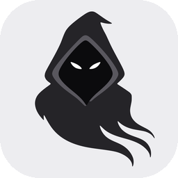
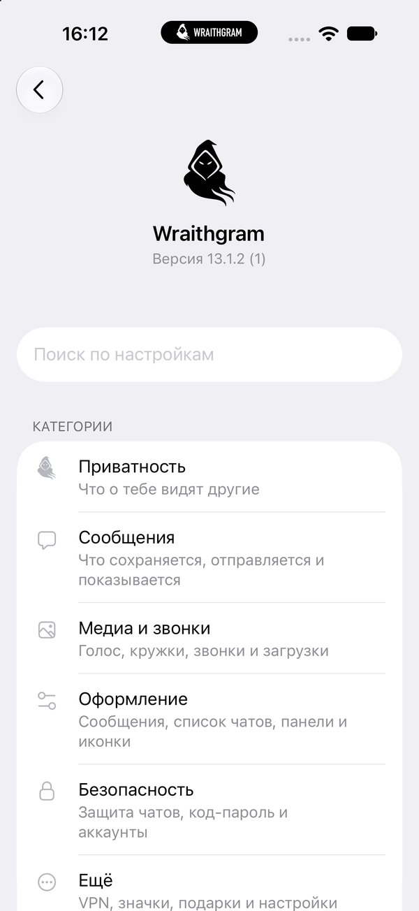
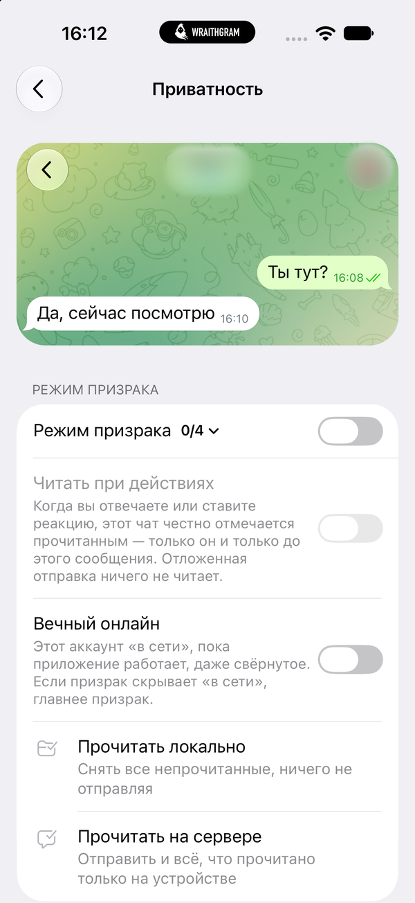
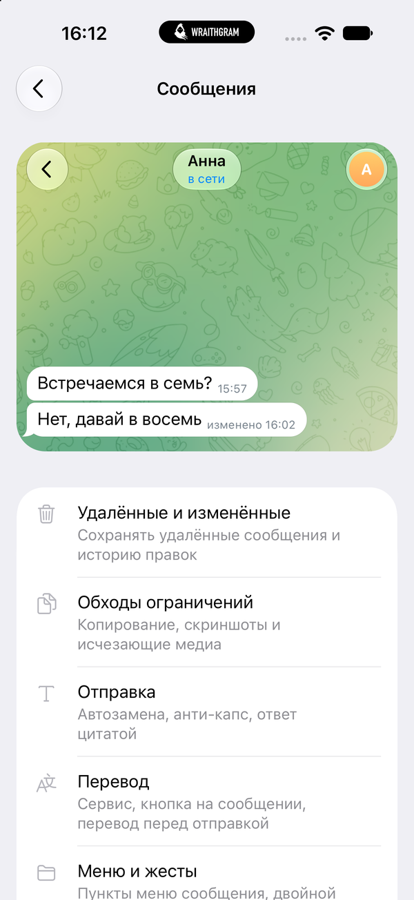
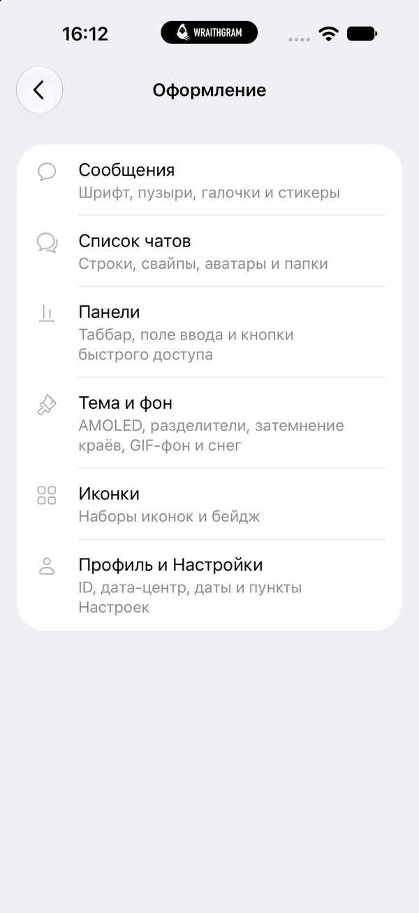

<p align="center">
  
</p>

<div align="center">

# Wraithgram

</div>

<p align="center">
  Неофициальный клиент Telegram для iOS с функциями приватности, истории сообщений и оформления.
</p>

<p align="center">
  
  
  
  
  <a href="LICENSE"></a>
</p>

<p align="center">
  <a href="README.md">🇬🇧 English</a> · 🇷🇺 <b>Русский</b>
</p>

Wraithgram — форк официального приложения [Telegram iOS](https://github.com/TelegramMessenger/Telegram-iOS)
(13.1.2), сделанный на основе форка [Ghostgram](https://github.com/ichmagmaus111/ghostgram):

```text
Telegram iOS  ──▶  Ghostgram (ichmagmaus111/ghostgram)  ──▶  Wraithgram
  приложение         функции приватности и оформления          этот репозиторий
```

Все его функции — в **Настройках → Wraithgram**, а функции из Swiftgram — в **Настройках → Swiftgram** и
**Настройках → Swiftgram Pro**. Wraithgram не связан с Telegram.

> [!WARNING]
> В репозитории лежат **собственные публичные значения Telegram**: `api_id` `8` и bundle ID
> `ph.telegra.Telegraph` в `build-system/wraithgram-configuration.example.json`, как в Telegram iOS и Ghostgram.
> Они годятся только для сборки под симулятор. **Замени их на свои** `api_id` и `api_hash` с
> [my.telegram.org](https://my.telegram.org) и свой bundle ID, прежде чем собирать для iPhone или делиться
> приложением. Подробности — в [Сборке Wraithgram](docs/ios/building.ru.md#сначала-свой-api_id-и-bundle-id).

<p align="center">
  
  
  
  
</p>

## Как получить Wraithgram

Готовых IPA нет: Wraithgram распространяется только исходным кодом. Собери его сам:

- **На своём Mac** с Xcode: сборка для симулятора или IPA для iPhone, которую ставишь через программу подписи,
  например ESign или LCSign, со своим сертификатом.
- **Через GitHub Actions** в своём форке, без Mac.

Оба способа по шагам описаны в [Сборке Wraithgram](docs/ios/building.ru.md).

## Чем Wraithgram отличается от Ghostgram

Wraithgram начат с кода Ghostgram по состоянию на ноябрь 2026 года. Поверх него добавлено:

- Строки **Swiftgram и Swiftgram Pro** в настройках Telegram, рядом с Wraithgram: все функции из Swiftgram
  собраны в одном месте.
- **Бэкап сессий** в Связку ключей iOS в формате Swiftgram: сохраняй аккаунты вручную или автоматически, убирай
  аккаунт из приложения и возвращай его позже без кода входа. Если задан код-пароль, экран его спрашивает.
- **Маленькие реакции**, **плоский стиль** нижней панели папок и переключатель, который не даёт приложению
  спрашивать у `dns.google.com` запасные адреса Telegram.
- **Ограничение размера** архива медиа удалённых сообщений; файлы удалённых записей тоже стираются.
- **Аватарки отправителей в уведомлениях** у сборок, переподписанных на устройстве.
- Своё название, иконка и схемы ссылок (`wraithgram://`, `wg://`). Он читает настройки и данные, оставшиеся от
  Ghostgram, поэтому может заменить Ghostgram без их потери.
- **Инструменты сборки:** IPA со всеми расширениями для программ подписи, сборка для симулятора без своих
  профилей, workflow для GitHub Actions и перенос новых релизов Telegram патчами.

## Функции

### Приватность

- **Режим призрака.** Читать сообщения и смотреть истории без отметок «прочитано» и «просмотрено», скрывать
  «печатает» и другие статусы, быть не в сети или всегда в сети. «Читать при действиях» отмечает чат
  прочитанным, когда ты отвечаешь или ставишь реакцию. Исключения по чатам, папкам и типам чатов.
- **Отложенная отправка:** пауза перед отправкой текста и медиа.
- **Анонимный режим:** маска на камеру и изменённый голос одним нажатием.
- **Подмена:** показывать другой номер телефона, открывать другой профиль вместо выбранного. И то и другое —
  только на твоём устройстве.

### Сообщения

- **Удалённые и изменённые.** Удалённые сообщения остаются в чате, у изменённых сохраняются прежние версии.
  Исключения, автоочистка, ограничение размера медиа.
- **Обходы ограничений:** копирование и скриншоты в защищённых чатах, сохранение исчезающих и одноразовых медиа,
  раскрытие спойлеров, открытие чатов, закрытых на iOS, скрытие рекламы.
- **Отправка:** правила автозамены, анти-капс, ответ цитатой, анонимные стикеры, без «via @bot».
- **Перевод:** перед отправкой, текст на фото, субтитры к видео по распознаванию речи.
- **Закладки и ссылки:** закладки, действия со ссылками, кнопки при выделении сообщений.
- **Экспорт чатов:** один чат или весь аккаунт в HTML и JSON.
- Безлимитные закрепы и история поиска, скрытие сообщений заблокированных, дополнения для групп и каналов.

### Медиа и звонки

- **Голос:** изменение голоса с пресетами и своим голосом (тон, тембр, реверберация, эхо…), эквалайзер,
  цитирование из расшифровки Telegram.
- **Кружки и камера:** AR-маски в кружках и видеозвонках, студия масок, настройки качества и камеры, водяной
  знак на видео и фото.
- **Звонки:** запись звонков, тихое выключение микрофона, звуки в звонке, статистика, звонки только через TCP,
  без просьб оценить звонок.
- **Загрузки и галерея:** статус загрузок, пункты галереи, картинка в картинке для YouTube, больше вариантов кэша.

### Оформление

- **Сообщения:** шрифты (из iOS или свои), пузыри, галочки, шапка чата.
- **Список чатов:** высота строк, аватары, кольца историй, скрытие текста сообщений.
- **Панели:** поле ввода, анимация набора, кнопки быстрого доступа, свой набор реакций.
- **Тема и фон:** AMOLED, разделители, затемнение краёв, анимированный GIF-фон для чатов и профилей.
- **Иконки:** наборы иконок интерфейса.
- **Профиль и Настройки:** пункты профиля и какие строки показывает вкладка «Настройки».

### Безопасность

- **Защита чатов:** код-пароль или Face ID на выбранные чаты, секретная папка, чаты скрыты на скриншотах и записи
  экрана.
- **Код-пароль:** больше вариантов автоблокировки, блокировка при каждом запуске, «заблокировать сейчас».
- **Аккаунты:** Face ID при смене аккаунта, настройки для каждого аккаунта, перенос настроек с другого аккаунта,
  подробности сеансов.

### Swiftgram

- **Список чатов и папки:** компактный список, строки превью, действия при свайпе, папки внизу.
- **Вкладки:** панель вкладок (скрыть, подписи, ширина, высота), бейдж под Dynamic Island.
- **Сообщения и чат:** маленькие реакции, размер стикеров, снегопад, настройки ввода, кнопки и жесты в чате,
  своё меню сообщения, сервис и кнопка перевода.
- **Медиа и загрузки:** ускорение загрузки и выгрузки, качество фото, настройки камеры и микрофона.
- **Истории:** скрыть истории, без свайпа к камере, предупреждение перед просмотром.
- **Профили:** дата регистрации, ID, дата-центр, даты.
- **Сеть:** без запросов к DNS Google.

### Swiftgram Pro

- Бэкап сессий, фильтр по словам, панель форматирования и автоформат, уведомления о закрепах и упоминаниях,
  автоблокировка через 5 секунд.

### Ещё

- **VPN по подписке:** VLESS-подписки и серверы. Ядро Xray загружается, только когда VPN включён.
- **Фейковые подарки:** подарки и звёзды в профиле, которые видишь только ты.
- **Настройки Wraithgram:** язык, экспорт и импорт всех настроек, сброс.

Интерфейс на английском, русском, украинском и арабском.

## Структура репозитория

```text
ios/
├── Wraithgram/           код Wraithgram
│   ├── WGCore/           настройки, строки, логи (общее, без интерфейса)
│   ├── WGHooks/          точки, где Wraithgram подключается к коду Telegram
│   ├── WGSettingsUI/     меню Wraithgram, Swiftgram и Swiftgram Pro
│   ├── Features/         функции, по модулю на каждую
│   └── Strings/          переводы и инструменты для них
├── build-system/         скрипты сборки (WG*.sh), патчи, шаблон конфигурации
├── docs/ios/             инструкции для iOS: сборка, подпись, переход на новый релиз Telegram
├── .github/workflows/    сборка через GitHub Actions
└── Telegram/, submodules/, third-party/, …
                          Telegram iOS; лежит в корне, потому что этого ждёт его сборка на Bazel
```

Правки в собственных файлах Telegram минимальны, помечены `// WRAITH:` и вызывают `WGHooks`. Новые релизы
Telegram переносятся патчами: смотри [Обновление до нового релиза Telegram iOS](docs/ios/upstream-sync.ru.md).
Как участвовать в разработке — в [Как вносить изменения](.github/CONTRIBUTING.ru.md).

## Благодарности

- [Telegram iOS](https://github.com/TelegramMessenger/Telegram-iOS) от Telegram: Wraithgram построен на его
  исходном коде.
- [ichmagmaus111/ghostgram](https://github.com/ichmagmaus111/ghostgram): Ghostgram, форк, на котором основан
  Wraithgram. Спасибо! Его сообщество в Telegram: [канал](https://t.me/ghostgrama),
  [чат](https://t.me/ghostgramchat) и [форум](https://t.me/ghostgramforum).
- [Swiftgram](https://github.com/Swiftgram/Telegram-iOS): клиент, из которого пришли функции разделов Swiftgram
  и Swiftgram Pro.

## Лицензия

Wraithgram распространяется по [GNU General Public License v2](LICENSE), как и исходный код Telegram iOS, на
котором он основан. Сторонние компоненты сохраняют свои лицензии; их список есть в приложении
(**Настройки → Wraithgram → Ещё → О приложении → Сторонние компоненты**).

Если собираешь своё приложение из этого кода, соблюдай
[правила Telegram для разработчиков](https://github.com/TelegramMessenger/Telegram-iOS#creating-your-telegram-application):
получи свой `api_id`, не называй приложение Telegram и не используй его логотип, заботься о приватности
пользователей и публикуй свой код.
